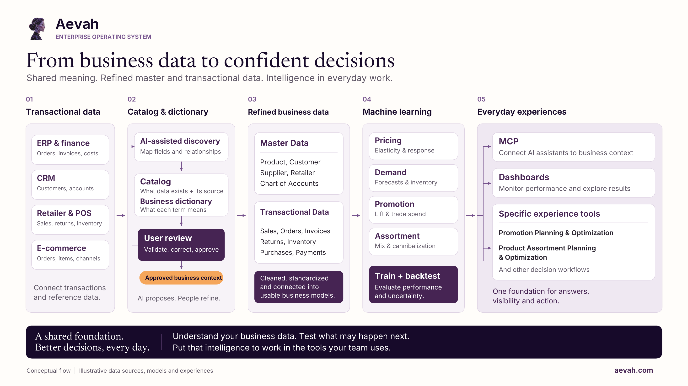

<!--
DRAFT v0.3 (2026-10-14) -- content for the styled trust document (builder: scripts/build_trust_document.py).
Audience: BUILT leadership and finance (Brian shares it). Aevah brand voice (docs/aevah_brand/brand/aevah-brand-guide.md).
Jason 2026-10-14 REFRAME: BUILT's trust question is VERACITY: "how we trace back an answer to original sources and
methods of calculation". Lead with provenance; security stays one sentence ("Mo runs on BUILT's own Azure subscription").
Facts: scout inventory 2026-10-14 (agents/project_memory.md live notes). Claim only what exists:
- lineage shown on cannibalization and price views (source, model, table, scored date); forecast views show "actuals
  through" only; model_version + scored_at stored with forecasts; score tables are REPLACED on refresh (not versioned);
  forecasts_registered/ is the permanent, tracked archive (since Sept 2026); per-number click-to-source audit trail is
  designed, NOT built; Mo Chat uses fixed tools, does not cite sources in answers; pipeline determinism check (wiki/18
  2202-2204); SPINS restates history ~3-4x/year, full re-ingest.
Rob's rules still apply (docs/drafts/aevah_trust_document_rob_checklist.md): no other security topics, no certification
wording, no data-residency absolutes, nothing unbuilt described as planned. No accuracy figures (ACCURACY_CLAIMS_REGISTER).
Vendor names: SPINS, Circana, NetSuite and Azure approved by Jason 2026-10-14 (do not name the database product).
Skeptic (opus/high) on v0.3: SURVIVES WITH EDITS; edits A-J applied 2026-10-14.
Jason 2026-10-14: eyebrow 'TRUST DOCUMENT · FOR BUILT' removed; Aevah platform diagram (assets/aevah_data_to_decisions.png,
conceptual/illustrative per its own footer) added after In brief.
Jason 2026-10-14: 'Price sensitivity' renamed 'Price elasticity' (one of Mo's three analytics).
v0.2 skeptic edits carried over; Jason's 2026-10-14 answers applied (Circana, Azure sentence, no "secure", no contact line).
-->

# How Mo works

**How every number in Mo traces back to its source data and the method that calculated it.**

Prepared by Aevah for BUILT · October 2026

## In brief

Mo is BUILT's demand intelligence experience, built and operated by Aevah. It turns BUILT's retail sales data into
demand forecasts, cannibalization and price elasticity, along with promotion reads and retailer views that BUILT's
teams can use directly.

For a finance team, a number is only as good as the ability to say where it came from. Mo is built so that every
figure has an answer to that question:

- **Every number starts in source data.** Mo's figures are calculated from SPINS weekly retail sales and BUILT's own
  records, loaded with their full history into Mo's data store.
- **Every number has a defined method.** Each kind of figure comes from a set calculation or a trained model,
  described in this document, never from a language model.
- **Every number can be traced.** Forecasts and model scores are stored with the model version and the date that
  produced them. The cannibalization and price views show each result's source, model and date, and the forecast
  views show the last week of actual sales they use.

## Tracing a number back to its source

Mo's figures follow the same path from source data to the screen.

1. **Source records.** SPINS weekly retail sales (the core), Circana for Costco, and BUILT's item master, including
   NetSuite item attributes, are loaded with all their fields and all the history delivered (weekly, from January
   2023). BUILT's shipments and trade promotion calendar are being added and evaluated.
2. **The data store.** Mo's data store, which holds the source records and the results the app reads, runs on BUILT's
   own Azure subscription.
3. **Calculation.** Aevah prepares the records and runs Mo's calculations and models when new SPINS data arrives, and
   checks the results before release. When Aevah compared two preparation runs on the same SPINS data, the sales and
   distribution figures were identical in all 186,451 records both runs contained.
4. **Stored results.** Model results are written back to the data store with the model version and the date they
   were produced. Each refresh replaces the previous results. Separately, Aevah keeps its own archive of saved
   forecasts, recorded before the sales data for the weeks they cover arrive, so they can later be checked against
   what actually sold; the first set was saved in October 2026.
5. **The Mo app and Mo Chat.** Both read results only through fixed, predefined data requests. The cannibalization
   and price views show, for the result being viewed, its source (SPINS weekly sales), the model that produced it,
   where it is stored and when it was calculated. The forecast views state the last week of actual sales they use.

### Example: following one forecast back

A planner looks at the 13-week forecast for one item at one retailer.

- **The view** states the last week of actual sales the forecast is based on.
- **The forecast** is a stored result in the data store, carrying the model version and the date it was produced.
- **The model version** names the trained model that produced it. Aevah's record for each model version lists its
  inputs: the item's recent sales and sales rate, its distribution at the retailer, prices and promotions, competing
  items on the shelf, the retailer, and the time of year.
- **Those inputs** are calculated from SPINS weekly records for that item, the retailer and the competing items
  around it, up to the stated week.
- **Stored forecasts are not edited afterward.** A forecast stays as produced until the next refresh replaces it,
  even if SPINS later revises the weeks it was based on.

## How each kind of number is calculated

| Figure | Source data | Method |
|---|---|---|
| Actual sales and distribution | SPINS weekly retail sales | Weekly figures as reported by SPINS: units, dollars, average prices, distribution and the number of stores selling each item |
| Everyday sales | SPINS weekly retail sales | SPINS's own baseline: its estimate of what sales would have been without promotions, used as reported |
| Demand forecast | SPINS weekly retail sales | Gradient-boosted decision trees (many small decision rules that each correct the last), with a separate model for each week ahead, 1 to 13 weeks; forecasts everyday sales and does not yet add expected promotion volume. Items that have stopped reporting use a simple expected-resume rule; items too new for the model get a simple trend forecast calculated when the view opens |
| Cannibalization score | SPINS weekly retail sales | A trained model scores how likely a newly launched item is to be drawing sales from each nearby item, BUILT's own and competitors', comparing up to 13 weeks after launch with the 13 weeks before (at least 8 of each); each score carries the three factors that most influenced it |
| Promotion response | SPINS promotion measures | How each item's sales have responded to past promotions, by type of promotion, from SPINS's own promotion measures |
| Price elasticity (how sales respond to price changes) | SPINS prices and units | A statistical model estimates whether sales tend to rise or fall with price changes, by item and retailer where there is enough price history; the direction is more reliable than the size, because most price changes happen during promotions |
| Mo Chat answers | Mo's stored results and source data | Retrieved through fixed, predefined data requests; the language model explains the figures it retrieves and does not produce Mo's forecasts or scores |

## How the numbers are checked

Aevah tests every forecasting change the way a finance team would want it tested:

- **Rewind and compare.** Aevah goes back to 18 earlier forecast dates, forecasts forward from each using only data up
  to that date, and compares with what actually sold, at the level of an item at a retailer, a retailer's month and
  BUILT's total month.
- **Simple yardsticks.** Every model is compared with rules a planner could use by hand, such as "assume recent sales
  continue" and "recent weekly sales per store × current store count".
- **Predictions written down first.** Before a test runs, Aevah records what it expects, so each result can be checked
  against what was expected.
- **Challenge before reporting.** Each forecasting result goes through a separate review step whose job is to try to
  break it. Results that do not survive are marked withdrawn in Aevah's records.
- **A switching rule set in advance.** The forecast BUILT sees changes only when a new method passes a rule written
  before testing: better on recent dates, consistent across forecast dates, no worse for established items, and no
  more prone to running high or low through the seasons.
- **Forward confirmation.** In October 2026, Aevah saved a set of forecasts before any sales data for the weeks they
  cover had arrived. They will be scored against what actually sold as that data arrives, with the full set expected
  early in 2027.

Mo's forecast changes only when a candidate passes this rule. Several alternatives, including neural networks and
blends of methods, have been tested so far, and none has met every condition. Forecast accuracy is still being
improved, and Aevah reports it only with the context below.

When Aevah reports accuracy, it states what was measured, at what level, how far ahead, compared with what simple
rule, and on how much data, because the same forecast can look very different at an item level and a company level.

## How Mo differs from generative AI

Generative AI tools built on large language models (LLMs) are remarkable at language: understanding questions,
summarizing and explaining. They produce fluent text by predicting likely words, which makes them a strong interface
but an unreliable source of business numbers. *LLMs generate. Aevah operates.*

| | Generative AI tools | Mo |
|---|---|---|
| Where numbers come from | Generated text; plausible but not calculated | Calculated by defined methods from BUILT's sales data |
| Tracing a number | Hard to tie an answer to a source | Source data, method, model version and date |
| Same question, same answer | Not guaranteed | Stored forecasts and scores stay the same until new data or a new model version is released; Mo Chat's wording can vary |
| Scale of data | What fits in a prompt | Millions of weekly records |
| Testing | Rarely tested against outcomes | Tested against what actually sold |

**Where Mo uses generative AI.** Mo Chat uses an AI language model to understand questions and explain answers in
plain English. It can only retrieve figures through a fixed set of predefined data requests; it cannot write its own
queries. It is instructed to use figures from Mo's data and never to invent data. The language model does not
calculate Mo's forecasts or scores.

## Where Mo's forecasts and scores get their data

| Source | What it provides | Status |
|---|---|---|
| SPINS weekly retail sales | Sales, prices, promotions and distribution for BUILT and the full category at more than 100 retail accounts | In use (the core) |
| Circana | Sales for Costco, which SPINS does not cover | Loaded into the data store |
| BUILT's item master | Items, product lines, pack details and NetSuite item attributes | In use |
| BUILT's NetSuite shipments | Shipments to retailers without store-level sales data | Being added and evaluated |
| BUILT's trade promotion calendar | Planned promotions by customer | Being added and evaluated |

Retail sales data are weekly figures, delivered in batches several weeks after the fact, so Mo's forecast views state
the last week of actual sales they use.

## Keeping the numbers honest

SPINS revises past weeks of its data, most often its everyday (baseline) sales measure, which it can recalculate as
far back as 35 weeks. When SPINS issues a full restatement, Aevah reloads the full history, and Mo's results are
recalculated at the next refresh. A stored result reflects the SPINS data as of the date it was produced. Aevah has
measured how much these revisions move past figures.

Saved forecasts can be compared with what actually sold once the sales data arrive. When Aevah finds an error
in its own work, the correction is recorded in Aevah's records alongside the original result rather than quietly
replaced.

## Where Mo runs

Mo runs on BUILT's own Azure subscription.
